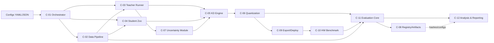
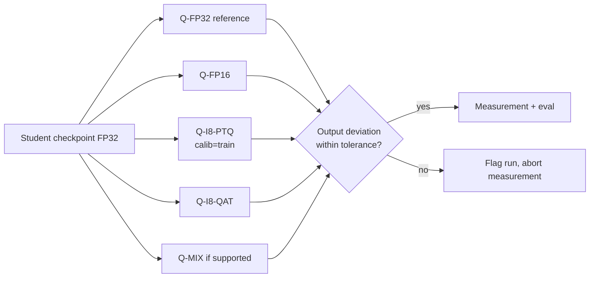
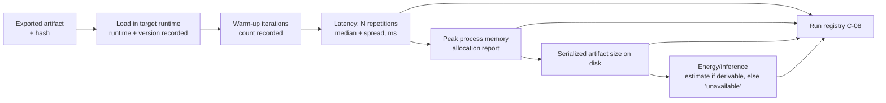
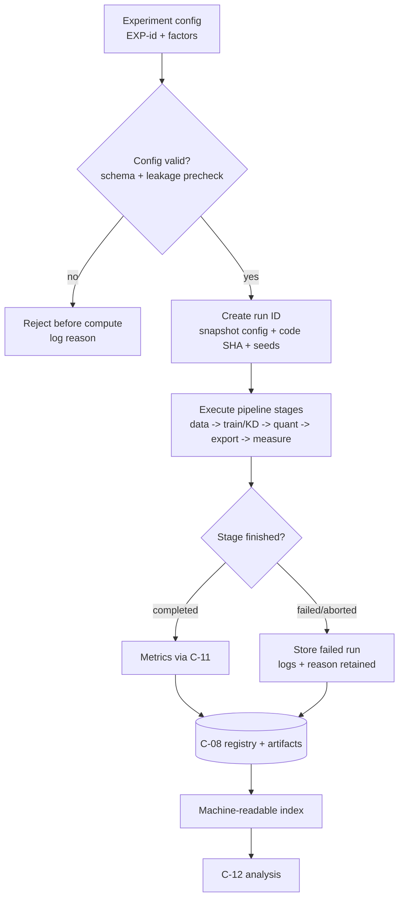
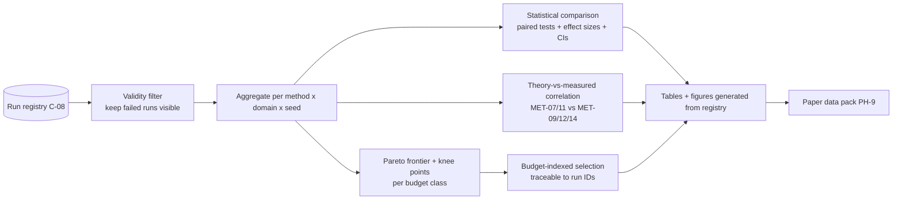

# architecture.md — Technical and Experimental Architecture

**Project:** KD-Edge-TinyML (see `prd.md` §1)

**Document role:** `architecture.md` explains *how* the research system is designed to satisfy the requirements in `prd.md`, under the constraints in `rules.md`. All components described here are **`PROPOSED` designs — no code has been written yet.** Where a concrete technology choice is not yet justified, selection criteria are given and the choice is marked `TO_VERIFY` (unresolved decisions U-01…U-12 in `memory.md` §8).

---

## 1. System Overview

The research system is a **config-driven experimentation framework** for studying knowledge distillation (KD) + quantization of time-series models under explicit software resource budgets (software-only scope, `D-006`). Its defining properties:

1. **One experiment = one config = one run ID.** Every result traces back to a stored config, code version, and data version (`NFR-002`, `NFR-004`).
2. **Measurement is separated from estimation.** Every numeric result carries a `measurement_type` ∈ {`measured`, `estimated`, `simulated`} (`NFR-008`).
3. **Pipelines are modular and swappable.** New teachers/students/datasets plug in via adapters without touching the evaluation core (`NFR-003`).
4. **The Pareto frontier is a first-class artifact**, not a by-product: the analysis layer consumes all runs and emits frontier/knee-point tables (`GAP-4`, `GAP-6`).

The system has no runtime product surface; its "users" are the researcher, the AI agent executing tasks, and third-party reproducers (`prd.md` §5).

---

## 2. Research-System Boundaries

| Inside the boundary | Outside the boundary |
|---|---|
| Data acquisition, preprocessing, domain-split management | The physical farm/field (data is pre-collected) |
| Teacher training/finetuning and inference | Pretraining foundation models from scratch |
| Student training with/without KD, uncertainty gating | Actuation/control decisions (not in scope) |
| Quantization (PTQ/QAT/mixed), export to the target runtime | Designing custom silicon or new runtimes |
| In-runtime benchmarking (latency / process memory / artifact size; energy estimate if derivable) | Manufacturing/field-deploying sensing hardware |
| Statistical analysis, Pareto/model selection, reporting | Peer review, submission decisions, acceptance outcomes |

Explicit external dependencies: dataset licensing, target-runtime availability (U-07), energy-estimator availability (U-08; no power instrumentation in scope — `D-006`), and compute budget (U-10).

---

## 3. High-Level Component Architecture

Component IDs are referenced by the traceability table in `prd.md` §15.

| ID | Component | Responsibility | Satisfies |
|---|---|---|---|
| C-01 | Experiment Orchestrator | Schedules/runs experiments from configs; isolates runs; captures seeds/env | REP-001, REP-002, NFR-002 |
| C-02 | Data Pipeline | Ingestion, validation, preprocessing, chronological + domain splits, leakage checks | FR-001–FR-006 |
| C-03 | Teacher Runner | Train/finetune/evaluate teachers; teacher inference caching | FR-007, FR-011 |
| C-04 | Student Model Zoo | Registry of student architectures × capacities; param/size reporting | FR-008, FR-009, MET-07 |
| C-05 | KD Engine | Distillation losses (logit/forecast, feature, temporal-relation), λ/temperature handling | FR-012, FR-014–FR-016 |
| C-06 | Quantization Pipeline | FP32→FP16→INT8 PTQ/QAT, mixed precision where supported; quantization correctness checks | FR-018–FR-022 |
| C-07 | Uncertainty & Reliability Module | Per-window teacher uncertainty extraction; reliability labels; gating functions | FR-010, FR-013 (RQ5) |
| C-08 | Artifact & Registry Store | Run registry, config snapshots, hashes, checkpoints, raw measurement logs | REP-002, REP-006, NFR-004 |
| C-09 | Export & Runtime Adapter | Convert students to the target runtime's serialized artifact; artifact hashing; export manifest | FR-026, FR-031 |
| C-10 | Runtime Benchmark Harness | In-runtime latency and peak-process-memory measurement; artifact-size reporting; energy estimate if derivable (software-only, `D-006`) | FR-027–FR-030 |
| C-11 | Evaluation Core | Single metric implementation for all models; per-domain and worst-group stats | FR-011, FR-019, FR-023, FR-024 |
| C-12 | Analysis & Reporting | Pareto frontiers, knee points, correlations (theory vs measured), stats, figures/tables | RQ4/RQ6 analysis, FR-034 |

**Boundary rules:** C-02 knows nothing about models; C-03/C-04/C-05 know nothing about the benchmark environment; C-10 knows nothing about training; only C-11 computes metrics; only C-12 produces reported numbers. Enforced as `NFR-001`.



*Status of this design: `PROPOSED`. Diagram must stay consistent with the table above (change both together).*

---

## 4. Data Flow

```mermaid
flowchart TD
  RAW[Raw dataset<br/>source domain + target domains] --> ING[Ingest & validate<br/>schema/gaps/license check]
  ING --> PRE[Preprocess<br/>resample/impute/normalize<br/>window lookback->horizon]
  PRE --> SPL[Split manager<br/>chronological + site/season holdout]
  SPL --> TR[Train split]
  SPL --> VA[Validation split]
  SPL --> TE[Test split]
  SPL --> TD[Target-domain split(s)]
  TR --> TRAIN[Training inputs]
  VA --> TUNE[Hyperparam/lambda/temperature selection]
  TE --> EVALTEST[Evaluation inputs]
  TD --> EVALSHIFT[Shifted-domain evaluation inputs]
  TR --> CAL[PTQ calibration set<br/>FR-020: train only]
```

Key invariants:

- Normalization statistics are computed **on the train split only** and applied unchanged to val/test/target (`rules.md` §C, FR-002).
- Split assignment is deterministic given the config and produces identical hashes on re-run (REP-003).
- A leakage check (no timestamp overlap; no target-domain window in train) runs automatically and **aborts** the run on failure (FR-006).

---

## 5. Training Flow

Shared skeleton for teacher, student, and QAT training — one trainer, three config modes:

1. Load config; fix seeds; record env and code version (C-01).
2. Materialize dataset splits (C-02).
3. Build model from registry (C-03 or C-04).
4. If distillation mode: precompute or stream teacher outputs + uncertainty signals (C-03 → C-07), cache keyed by teacher hash + data hash.
5. Optimize with the configured objective:
   - Teacher/baseline: task loss only.
   - Student + KD: `L = L_task(student, y) + λ · g(t) · L_kd(student, teacher)` where `g(t)` is the gating term (1.0 for ungated KD — this makes ungated KD a strict special case, enabling the gating-only ablation, FR-013).
   - QAT: task (+ optional KD) loss with fake-quantization nodes active.
6. Select checkpoint on **validation** metric; never test.
7. Emit: checkpoint (hashed), training log, run manifest (all settings, FR-014/FR-022).

All training runs are reproducible given config + seed, subject to documented nondeterminism of some GPU kernels (recorded, REP-002).

---

## 6. Teacher-Model Workflow

| Step | Action | Notes |
|---|---|---|
| TS-1 | Teacher selection against documented criteria (capability, license, compute fit, uncertainty availability) | Choice `TO_VERIFY` (U-01); criteria fixed **before** selection |
| TS-2 | Train or finetune on **source domain** only | Teachers never see target-domain labels |
| TS-3 | Evaluate on in-domain test + target domains | Produces the reference column of every comparison (not deployable) |
| TS-4 | Produce cached inference: point forecast + uncertainty signal per window | Uncertainty options (`TO_VERIFY` U-05): native quantiles; ensemble/checkpoint spread; MC-dropout; residual-based proxy |
| TS-5 | Export teacher footprint metrics (params, size, FLOPs) | Needed for retention ratios (FR-016) and RQ4 |

Failure handling: if a teacher cannot expose any uncertainty signal, it is **excluded from EXP-006** (not from EXP-003), with the reason recorded (FR-010, `rules.md` §B).

---

## 7. Student-Model Workflow

| Step | Action | Notes |
|---|---|---|
| SS-1 | Register candidate families × capacities | ≥2 families × ≥3 capacities (FR-008); INT8-friendly ops prioritized |
| SS-2 | Train no-KD baseline per configuration | Mandatory baseline before any KD claim (`rules.md` §C) |
| SS-3 | Train with each KD strategy | Same budget/splits as SS-2 for fair comparison |
| SS-4 | Quantize per regime (C-06) | FP16 / INT8 PTQ / INT8 QAT / mixed-if-supported |
| SS-5 | Export candidate set for runtime measurement | Selection for EXP-010/EXP-011 by Pareto pre-screening (host-measured) |

Planned families (`PROPOSED`, specifics `TO_VERIFY` U-02): tiny CNN/TCN; compact Transformer or Mamba-style sequence model; an explicitly deployment-oriented configuration (INT8-friendly ops only, no unsupported layers). Capacity levels defined by target parameter bands, not by arbitrary names — bands chosen in PH-3 after teacher scale is known.

---

## 8. Knowledge-Distillation Pipeline

| Variant ID | Name | Loss target | Status |
|---|---|---|---|
| KD-0 | None (baseline) | task loss only | baseline |
| KD-1 | Logit/forecast distillation | teacher's future-window outputs | `PROPOSED` |
| KD-2 | Feature distillation | intermediate representations (projection-matched) | `PROPOSED` |
| KD-3 | Temporal-relation distillation | pairwise/temporal similarity structure of teacher outputs | `PROPOSED` |
| KD-4 | Uncertainty/reliability-gated distillation (candidate contribution) | KD-1/2/3 weighted by gate `g(t)` from C-07 | `PROPOSED` (novelty `TO_VERIFY`, PH-1) |

Design constraints:

- KD-4 must reduce to KD-1/2/3 when `g(t) ≡ 1` (ablation completeness, FR-013).
- Temperature, λ, and gate hyperparameters are swept **on validation only**, recorded per run (FR-014).
- Teacher outputs are cached and hash-keyed so KD comparisons share identical teacher signals (fairness, `rules.md` §C).

## 9. Uncertainty / Reliability-Estimation Component (C-07)

*Retained in the design as `PROPOSED`; removal is a design decision pending PH-1/PH-4 (U-05).*

- **Inputs:** teacher cached outputs; teacher uncertainty signal; optional target-domain unlabeled data.
- **Outputs:** per-window gate value `g(t) ∈ [0,1]`; reliability labels used for analysis (not for training the gate, unless explicitly configured).
- **Candidate gate constructions (`TO_VERIFY`):** monotone transform of teacher uncertainty; ranking/quantile-based clipping of high-uncertainty windows; a learned calibration map fit on validation only.
- **Anti-leakage rule:** the gate may use signals computable at deployment time or fit on validation data only — never target-domain labels at training time (else it is labeled "oracle gate" and reported separately as an upper reference, `rules.md` §C).

---

## 10. Quantization Pipeline

| Regime | Method | Notes |
|---|---|---|
| Q-FP32 | Reference | Unquantized student (and teacher where relevant) |
| Q-FP16 | Cast/quantize to 16-bit | Baseline compression step |
| Q-I8-PTQ | Post-training INT8 | Calibration set from train only (FR-020); per-channel/per-tensor recorded (FR-021) |
| Q-I8-QAT | Quantization-aware training | Init from FP32 checkpoint; epochs/LR recorded (FR-022) |
| Q-MIX | Mixed INT8/INT4 | **Only where toolchain+runtime support it** (FR-018); otherwise documented as unsupported, not silently skipped (U-09) |

Correctness check before measurement: quantized model outputs compared against FP32 reference on a held-out batch; deviation beyond configured tolerance aborts measurement and flags the run (FR-019 support).



---

## 11. Domain-Shift Pipeline

- Domain assignment (source vs target) is a property of the split manager (C-02), configured in PH-2 **before** experiments run.
- Natural shift is preferred (held-out site/season). Synthetic shift (e.g., injected noise/drift) is allowed only if labeled synthetic everywhere (FR-025).
- Pipelines that use the shift: EXP-005 (distillation strategies under shift), EXP-006 (gating under teacher mismatch), EXP-012 (robustness/failure analysis).
- The teacher is trained on source only; students may be distilled on source and fine-tuned/evaluated per the PH-2 protocol — every combination used is explicit in the config (no silent mixing of domains).

---

## 12. Evaluation Pipeline (C-11)

Single metric implementation used for **all** models (FR-011):

- Inputs: predictions + ground truth + domain label + window metadata.
- Outputs: metric vector per `prd.md` §12 (MET-01…MET-16), tagged with `measurement_type`.
- Aggregation: mean, dispersion across seeds (MET-16), per-domain and worst-domain (MET-05), error percentiles (p50/p90/p95).
- Calibration/uncertainty metrics (MET-06) computed only when both predictions and uncertainty estimates exist; metric choice `TO_VERIFY` (U-11).

---

## 13. Software Benchmarking Pipeline



Measurement rules (`rules.md` §D) enforced by this pipeline:

- OS, CPU/GPU, runtime/compiler versions, thread and power/thermal settings recorded.
- Warm-up, repetition count, and units recorded; raw per-repetition values stored (FR-027).
- Peak process memory ≠ artifact size on disk ≠ total host memory — reported separately (FR-028).
- **No runtime/edge-compatibility claim without a recorded run in that runtime** (FR-031).
- FLOPs/params and any energy figure are labeled `estimated`/`simulated` and never merged into measured columns (NFR-008).

Target environment (software-only, `D-006`): at least one reproducible software runtime (`PROPOSED`: pinned OS + Python/library stack on a documented CPU or GPU; U-07), plus optionally a second environment (different OS, CPU/GPU class, or vendored runtime; U-12). Runtime choice (e.g., an INT8-capable inference runtime such as ONNX Runtime or PyTorch quantization tooling) `TO_VERIFY` against model-op support.

---

## 14. Experiment Logging and Artifact Management (C-08)

Every run record contains: run ID, config snapshot (full), code version (git SHA), environment/lockfile hash, dataset version + split hashes, seed(s), model IDs + checkpoint hashes, quantization settings, runtime/library versions and CPU/GPU where relevant, metric vector, artifact paths, status (`completed`/`failed`/`aborted`), and free-text observations.

Artifact store layout (proposed): `artifacts/runs/<run_id>/{config, checkpoints, logs, measurements}/` with a top-level index (machine-readable) consumed by C-12. Failed runs are stored identically (`rules.md` §B).

**Experiment execution flow** (diagram 3 of 4 required by the documentation specification):



Failed runs are first-class registry entries: they are excluded from aggregates but never deleted (`rules.md` §B5, FR-017).

## 15. Reproducibility Mechanisms

- Pinned environment (lockfile) + one documented entry point per experiment class (REP-001).
- Deterministic splits (REP-003) and recorded seeds (REP-002).
- Hashes for data, checkpoints, exported binaries (REP-006).
- Reproduction re-run of critical configs with tolerance check (REP-004; tolerance `TO_VERIFY`).
- Release packaging checklist (REP-007).

## 16. Results-Analysis Pipeline (C-12)

Inputs: run registry (C-08) only — **analysis never reads ad-hoc numbers**.
Processing:

1. Validity filter (exclude flagged/failed runs; keep them visible with status).
2. Pareto frontier construction over (error, latency, peak process memory, artifact size, energy estimate if available) per budget class.
3. Knee-point identification (method `TO_VERIFY`; e.g., distance-to-ideal or curvature-based) with bootstrap confidence bands.
4. Theory-vs-measured correlation analysis (RQ4): Spearman/Pearson between MET-07/11 and MET-09/12/14.
5. Statistical comparisons (EXP-014): paired tests, effect sizes, CIs.
6. Figure/table generation directly from registry data (no hand-typed numbers in figures).

Outputs: comparison tables, frontier plots, failure-case dossiers, and a draft "results" data pack for the paper (PH-9).

**Evaluation and reporting flow** (diagram 4 of 4 required by the documentation specification):



Every reported value carries `measurement_type` = measured / estimated / simulated (`NFR-008`), and no figure is produced by hand (C-12 outputs only).

## 17. Dataset and Model Interfaces

| Interface | Contract |
|---|---|
| Dataset adapter | Yields aligned multivariate windows `(X_lookback, y_horizon)` + timestamps + domain/site/season labels; declares sampling rate and gaps; deterministic given split config |
| Model adapter (teacher/student) | `train(batch)`, `predict(window) -> forecast`, `uncertainty(window) -> signal-or-none`, `footprint() -> {params, size_bytes}`, `export(runtime) -> binary-or-none` |
| Quantizer adapter | `apply(model, regime, calibration_data) -> quantized_model + settings_record` |
| Runtime adapter | `load(artifact)`, `measure(model, inputs, repetitions) -> {latency_samples, peak_process_memory, artifact_size, energy-or-none}` |
| Metric adapter | Pure function `(predictions, targets, metadata) -> metric dict` |

Adding a model/dataset = implementing one adapter + registering it (NFR-003); core pipelines unchanged.

## 18. Component Responsibilities

Covered in §3 table (responsibility + requirements satisfied). Additional rule: each component has exactly one owner module in the repository (§21) to keep boundaries enforceable.

## 19. Inputs and Outputs per Component

| ID | Key inputs | Key outputs |
|---|---|---|
| C-01 | Experiment configs | Run IDs, orchestration logs |
| C-02 | Raw dataset, split config | Split datasets, manifests, leakage report |
| C-03 | Split data, teacher config | Checkpoints, cached teacher outputs + uncertainty, teacher metrics |
| C-04 | Student config | Model instances, param/size reports |
| C-05 | Student batch, teacher signals, λ/T/gate config | Training loss curves, distilled checkpoints |
| C-06 | FP32 checkpoints, calibration data, regime | Quantized checkpoints + settings records |
| C-07 | Teacher uncertainty, config | Gate values, reliability labels |
| C-08 | Everything above | Run registry, artifact index, hashes |
| C-09 | Quantized checkpoint | Runtime artifact + export manifest |
| C-10 | Binary, input traces, methodology | Raw measurement logs |
| C-11 | Predictions/targets/metadata | Metric vectors |
| C-12 | Run registry | Frontiers, tables, figures, stats reports |

## 20. Error Handling and Failure Cases

| Failure | Behavior |
|---|---|
| Data missing/corrupt/schema mismatch | Abort run with explicit error (FR-006) |
| Leakage check fails | Abort run; log offending overlap |
| Teacher lacks uncertainty signal | Exclude from EXP-006 only; record reason |
| Export unsupported ops for target runtime | Mark model non-exportable; record offending ops; continue other models |
| Quantized output deviation out of tolerance | Flag run; no measurement |
| Runtime load/run failure | Record as deployment failure (a valid result for RQ1/RQ4); never silently dropped |
| No energy estimator available | MET-14 = "unavailable" with statement (FR-030) |
| Training divergence | Store failed run with logs (FR-017) |
| Seed dropped for any reason | Documented in run registry and `memory.md` §14 |

## 21. Expected Repository Structure

*(Proposed; root location `TO_VERIFY` — the seven documentation files currently live in `Knowledge Distillation/`.)*

```text
kd-edge-tinyml/
  docs/                      # prd.md, architecture.md, rules.md, phases.md, memory.md, goal.md, task.md
  configs/
    experiments/             # one YAML/JSON per experiment
    models/ teachers/ students/ quant/
  src/
    data/                    # C-02
    teachers/                # C-03
    students/                # C-04
    kd/                      # C-05
    quant/                   # C-06
    uncertainty/             # C-07
    registry/                # C-08
    deploy/                  # C-09
    bench/                   # C-10 (benchmark harness scripts)
    eval/                    # C-11
    analysis/                # C-12
  scripts/                   # entry points (REP-001)
  tests/                     # unit + leakage/negative tests
  artifacts/                 # run outputs (not committed; indexed)
  results/                   # registry index + generated tables/figures
  environment.lock / pyproject-or-equivalent
```

## 22. Architecture Decisions That Remain Unresolved

| ID | Decision | Selection criteria (until decided) | Task |
|---|---|---|---|
| U-01 | Teacher set (which time-series foundation/large models) | License OK, runs within compute, uncertainty availability, forecasting capability on DST-01 | T-013, T-031 |
| U-02 | Student families/capacities | INT8-friendly ops, exportability to target runtime, capacity bands | T-032 |
| U-03 | Dataset (DST-01) | `prd.md` §16 DST-R1–R5 | T-021 |
| U-04 | Prediction task (target variable, lookback, horizon) | Fit to student capacity + runtime latency budget | T-022 |
| U-05 | Uncertainty estimation per teacher | Availability, cost, deployment-time computability | T-041 |
| U-06 | Gating function form + λ selection rule | Validation-only selection; ablatable; monotone in uncertainty | T-042 |
| U-07 | Target software runtime + environment (OS/library stack, CPU or GPU) | Toolchain support for student ops + INT8/INT4; environment availability | T-060 |
| U-08 | Energy estimation method (no power instrumentation in scope, `D-006`) | Estimator availability; documented methodology | T-065 |
| U-09 | Mixed INT8/INT4 feasibility | Toolchain/runtime support | T-051 |
| U-10 | Compute budget and where training runs | Available compute; wall-clock limits | T-012 |
| U-11 | Calibration metric + statistical test set | Standard practice in target venue; justified in PH-7 | T-072 |
| U-12 | Inclusion of a second software environment | Environment availability; marginal cost vs RQ4 value | T-061 |

No technology, framework, dataset, model, or runtime named in this file is `DECIDED` yet; names above are candidates (`PROPOSED`/`TO_VERIFY`).
